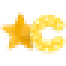

#  Starcord

[](https://discord.gg/DdYg5CrkXz)
[](./LICENSE)

Starcord is a Discord client mod with over 370 plugins. It's built on [Equicord](https://github.com/Equicord/Equicord) and [Vencord](https://github.com/Vendicated/Vencord), and adds its own features on top.

Join the [Starcord Discord server](https://discord.gg/DdYg5CrkXz) for updates, chatting, or support.

## Features

Everything from Equicord and Vencord, plus:

- **Optimized Discord**: one toggle in the Starcord settings that removes animations, including animated profile pictures, server icons and profile effects, so Discord feels faster
- **Platform Spoofer**: a button next to Help in the top right that lets you appear on desktop, web, mobile, Xbox, PlayStation or VR
- **BetterDiscord themes**: browse and install every theme from the BetterDiscord theme store, right in the Themes tab
- **FakeDeafen**: appear deafened or muted to others while you can still hear and talk
- **CtrlClickDelete**: hold Ctrl and click one of your messages to delete it instantly
- **DMVoiceView**: see which of your DMs are in a voice channel and click to view it
- **FollowVoiceUserEnhanced**: follow a friend between voice channels, with notifications, and keep following them after a restart
- **CursorBuddy feeding**: feed your cursor buddy hay or fish and watch it grow
- **StarcordUsers**: every Starcord user gets a number and a badge, with a star next to their name in the member list, DMs and voice channels. Toggle any Discord badge from the badge button in the top right, which other Starcord users see too, and set a display name and username that only you see from the name button next to it

Plugins made for Starcord live in `src/starcordplugins`, Equicord's in `src/equicordplugins` and Vencord's in `src/plugins`. Each plugin shows where it comes from in the plugin list.

## Installing

Download the installer for your system from the [latest release](../../releases/latest):

| System | Download |
| --- | --- |
| Windows | [StarCordInstaller.exe](../../releases/latest/download/StarCordInstaller.exe) |
| Linux | [StarCordInstaller-Linux](../../releases/latest/download/StarCordInstaller-Linux) |

1. Close Discord.
2. Open the installer. On Linux, first make it runnable with `chmod +x StarCordInstaller-Linux`.
3. It finds your Discord installation automatically. Click **Patch**.
4. Start Discord.

To uninstall, open the installer again and click **Unpatch**.

> [!NOTE]
> Windows may warn that the installer is from an unknown publisher, because it isn't code signed. Click **More info**, then **Run anyway**.

## Building from source

[Git](https://git-scm.com/download), [Node.JS LTS](https://nodejs.dev/en/) and [pnpm](https://pnpm.io/installation) are required.

> [!IMPORTANT]
> Don't use an admin/root terminal for these steps. It **will** mess up your Discord/Starcord install.

```shell
git clone https://github.com/mysisnotreal/StarCord
cd StarCord
pnpm install --frozen-lockfile
pnpm build
```

Then patch Discord with the installer in the `installer` folder, which uses your local build when run from the repository:

```shell
python3 installer/StarcordInstaller.pyw
```

`pnpm inject` works too. It uses Equicord's installer, [Equilotl](https://github.com/Equicord/Equilotl), pointed at your local build.

To build the browser extension, run `pnpm buildWeb` and load the ZIP file from the `dist` folder in your browser. The Firefox extension needs Firefox Developer Edition.

To pull in changes from Equicord:

```shell
git fetch upstream
git merge upstream/main
```

## Updating

Starcord has no built in updater. Download the newest installer and click **Patch** again, or if you built from source, pull the latest changes and run `pnpm build`.

## Credits

Starcord is built on [Equicord](https://github.com/Equicord/Equicord) and all of its contributors, which is a fork of [Vencord](https://github.com/Vendicated/Vencord) by [Vendicated](https://github.com/Vendicated). Thanks to [Suncord](https://github.com/verticalsync/Suncord) by [verticalsync](https://github.com/verticalsync) for helping Equicord, to [hyyven](https://github.com/hyyven/Vencord-FakeDeafen) for the FakeDeafen plugin, and to [mezotv](https://github.com/mezotv/discord-badges) for the Discord badge images.

## License

Starcord is licensed under the [GNU General Public License v3.0](./LICENSE), like Equicord and Vencord.

## Disclaimer

Discord is a trademark of Discord Inc., and is only mentioned to describe what Starcord works with.
Mentioning it does not imply any affiliation with or endorsement by Discord Inc.
Starcord is not affiliated with Vencord or Equicord.

<details>
<summary>Using Starcord violates Discord's terms of service</summary>

Client modifications are against Discord’s Terms of Service.

However, Discord is pretty indifferent about them and there are no known cases of users getting banned for using client mods! So you should generally be fine if you don’t use plugins that implement abusive behaviour. But no worries, all inbuilt plugins are safe to use!

Regardless, if your account is essential to you and getting disabled would be a disaster for you, you should probably not use any client mods (not exclusive to Starcord), just to be safe.

Additionally, make sure not to post screenshots with Starcord in a server where you might get banned for it.

</details>
